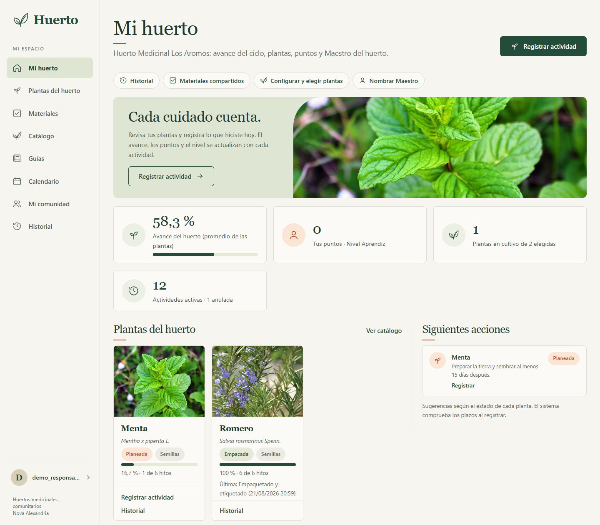
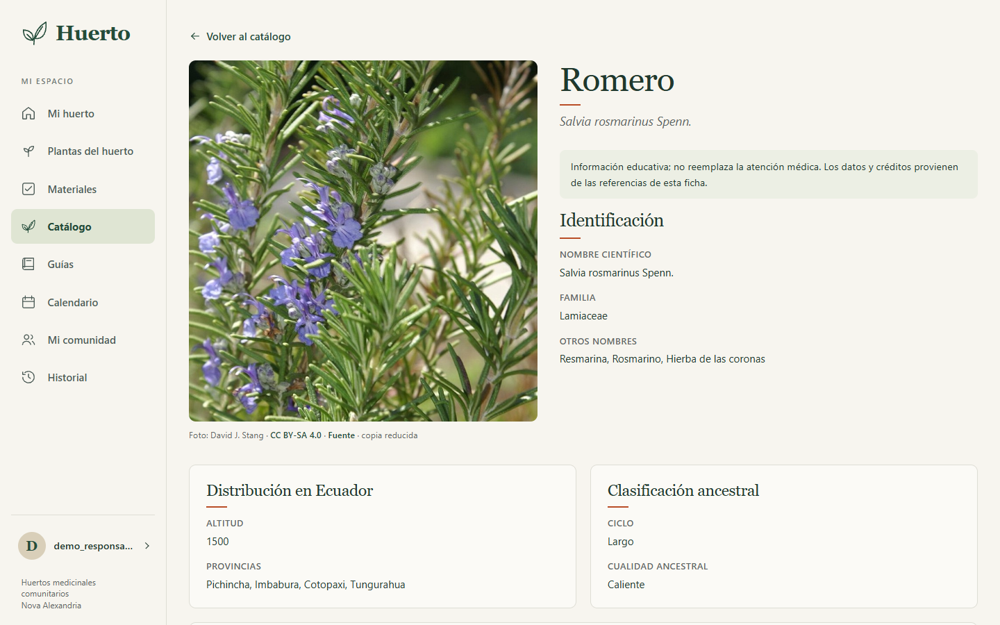

# Huertos medicinales comunitarios - Nova Alexandria - Versión 1

Aplicación web para configurar un huerto medicinal comunitario, consultar saberes ancestrales,
registrar actividades y observar plantas, puntos y niveles.

Proyecto de **Calidad de Software (ISWD652, período 2026B)**.

- EPN - 2026B
- GR1SW
- Integrantes: Domenica Astudillo, Bryan Ayala, Fernando Carrera, Guillermo Cevallos, Juan Chugá, Matthew Redin

[Enlace de la carpeta compartida de la documentación](https://epnecuador-my.sharepoint.com/:f:/r/personal/juan_chuga_epn_edu_ec/_layouts/15/onedrive.aspx?id=%2Fpersonal%2Fjuan%5Fchuga%5Fepn%5Fedu%5Fec%2FDocuments%2FCalidad%20de%20Software&share=cgpAPIBlWcTlRoYB2Hgn%2DozUEgUC0pr97Omw7s%5F5ECGaECVdCA)

---

## Estado actual del proyecto

- Estado al 8 de noviembre de 2026. `main` integra el trabajo de todo el equipo y las doce historias de usuario están implementadas, los casos de prueba han sido ejecutados y el informe está terminado.

-  carga del catálogo contiene **18 fichas**, **13 guías**, **23 opciones**, **18 materiales** y **17 eventos lunares**. Las 188 pruebas automáticas pasan; son comprobaciones de desarrollo y no sustituyen a los casos formales.

- El escenario ficticio de demostración está preparado mediante `scripts/crear_demo.py`. Incluye dos comunidades, cuatro cuentas ficticias, dos huertos, actividades de un ciclo avanzado y un participante nombrado Maestro. La copia de la base se mantiene fuera de Git.


---

## Contenido

1. [Tecnologías y versiones](#1-tecnologías-y-versiones)
2. [Requisitos previos](#2-requisitos-previos)
3. [Instalación paso a paso](#3-instalación-paso-a-paso)
4. [Uso diario](#4-uso-diario)
5. [Pruebas](#5-pruebas)
6. [Arquitectura](#6-arquitectura)
7. [Estructura del proyecto](#7-estructura-del-proyecto)
8. [Reglas de trabajo con Git](#8-reglas-de-trabajo-con-git)
9. [Base de datos de demostración](#9-base-de-datos-de-demostración)
10. [Documentación](#10-documentación)

---

## 1. Tecnologías y versiones

| Pieza | Versión | Notas |
|---|---|---|
| Python | **3.13.14** | Todo el equipo usa el mismo parche. No se mezclan versiones menores. |
| Django | **5.2.18 (LTS)** | Fijado exactamente en `requirements.txt`. |
| Base de datos | SQLite | Incluida en Python. Transacciones `IMMEDIATE`, espera de 5 s. |
| tzdata | 2026.5 | Zona horaria `America/Guayaquil` en Windows. |
| Interfaz | Plantillas Django + Bootstrap 5.3.8 + CSS local | Recursos incorporados: la demo funciona sin internet. |
| Pruebas | Django `TestCase` + `manage.py test` | Un `tests.py` por aplicación. |
| Control de versiones | Git y GitHub | Repositorio de la organización NovaAlexandriaEPN. |

## 2. Requisitos previos

- Windows 10/11 con PowerShell.
- **Git** instalado (`git --version`).
- **Python 3.13.14**. Comprueba que el lanzador `py` lo encuentra:

  ```powershell
  py -0p
  py -3.13 --version
  ```

  Debe aparecer `Python 3.13.14`. Si no está instalado, descárgalo desde
  <https://www.python.org/downloads/windows/> (marca *Add python.exe to PATH*) o usa
  el administrador de instalaciones de Python con `py install 3.13`.

> Si tienes otra versión (por ejemplo 3.14) instalada, no importa: el entorno virtual se crea
> explícitamente con `py -3.13`.

## 3. Instalación paso a paso

Todos los comandos se ejecutan en **PowerShell**. Desde el paso 3.2, se ejecutan dentro de la
carpeta del repositorio.

### 3.1 Clonar el repositorio

```powershell
git clone https://github.com/NovaAlexandriaEPN/repositorio-huertos.git
Set-Location -LiteralPath .\repositorio-huertos
```

### 3.2 Crear el entorno virtual

```powershell
py -3.13 -m venv .venv
& .\.venv\Scripts\python.exe --version
```

Debe mostrar `Python 3.13.14`. Los comandos de esta guía llaman directamente al Python de
`.venv`; no necesitan activar el entorno ni cambiar la política de ejecución de PowerShell.

### 3.3 Instalar dependencias

```powershell
& .\.venv\Scripts\python.exe -m pip install -r requirements.txt
& .\.venv\Scripts\python.exe -m pip check
```

### 3.4 Clave secreta (`DJANGO_SECRET_KEY`)

`huertos/settings.py` lee la clave de la variable de entorno `DJANGO_SECRET_KEY`.
**Cada integrante genera su propia clave local, la conserva y nunca la sube a Git.**
Esto se hace **una sola vez** por computador y **antes de `migrate`**.

```powershell
# Reutilizar la clave del usuario de Windows si ya existe.
$claveHuertosLocal = [Environment]::GetEnvironmentVariable('DJANGO_SECRET_KEY', 'User')
if ([string]::IsNullOrWhiteSpace($claveHuertosLocal)) {
    $claveHuertosLocal = & .\.venv\Scripts\python.exe -c "import secrets; print(secrets.token_urlsafe(50))"
    if ($LASTEXITCODE -ne 0) { throw 'No se pudo generar la clave local.' }
    [Environment]::SetEnvironmentVariable('DJANGO_SECRET_KEY', $claveHuertosLocal, 'User')
}
$env:DJANGO_SECRET_KEY = $claveHuertosLocal
Remove-Variable claveHuertosLocal
```

Comprueba que está cargada en esta terminal:

```powershell
[bool]$env:DJANGO_SECRET_KEY  # Debe mostrar True, sin imprimir la clave.
```

> No cambies la clave después de crear datos: las sesiones iniciadas dejarían de ser válidas.

### 3.5 Crear la base de datos y cargar el catálogo

```powershell
& .\.venv\Scripts\python.exe manage.py check
& .\.venv\Scripts\python.exe manage.py migrate
& .\.venv\Scripts\python.exe manage.py cargar_catalogo
```

Esto crea las tablas de los cuatro módulos y carga los datos fijos del catálogo. En una base
nueva, `cargar_catalogo` crea 89 registros y muestra una línea por modelo, por ejemplo:

```text
Planta: entregados 18, nuevos 18, ya existían 0 (0 con contenido distinto), en la base 18.
```

- **nuevos**: códigos que no existían y se crearon ahora.
- **ya existían**: códigos que se conservaron sin modificar.
- **con contenido distinto**: códigos existentes cuyo contenido no coincide con el archivo
  Python. No se sobrescriben; para ver cuáles son, ejecuta
  `& .\.venv\Scripts\python.exe manage.py cargar_catalogo -v 2`.

Repetir la carga no duplica registros ni toca cuentas, comunidades, huertos o actividades. Si
una ficha trae un campo que el modelo no tiene, el comando se detiene sin guardar nada e indica
la ficha y el campo. Git actualiza los archivos, pero no el contenido de SQLite: para corregir
una base antigua, consulta
[la actualización de bases existentes](docs/v1/integracion_equipo.md#actualización-de-bases-existentes).

### 3.6 Levantar el servidor

```powershell
& .\.venv\Scripts\python.exe manage.py runserver
```

Abrir <http://127.0.0.1:8000/>. Sin sesión lleva al inicio de sesión; el enlace «Crear cuenta»
permite registrarse. Detener el servidor con `Ctrl + C`.

Así, el servidor solo responde en este computador. Para abrirlo desde un celular u otro equipo,
usa la sección 3.7.

### 3.7 Abrir la aplicación desde otro dispositivo de la red

El celular u otro computador deben estar conectados a **la misma red** que el computador que
ejecuta el servidor. Ejecuta este bloque cada vez que cambies de red: detecta las direcciones IP
de la red actual, las permite en Django y muestra la dirección que debes abrir.

```powershell
# 1. Permitir en Django las direcciones IPv4 de este computador en la red actual.
$ipsHuertos = Get-NetIPAddress -AddressFamily IPv4 -AddressState Preferred |
    Where-Object { $_.IPAddress -notlike '127.*' -and $_.IPAddress -notlike '169.254.*' }
$env:DJANGO_ALLOWED_HOSTS = $ipsHuertos.IPAddress -join ','

# 2. Elegir la conexión con salida a la red, para mostrar la dirección correcta.
$rutaHuertos = Get-NetRoute -AddressFamily IPv4 -DestinationPrefix '0.0.0.0/0' -ErrorAction SilentlyContinue |
    Sort-Object { $_.RouteMetric + (Get-NetIPInterface -InterfaceIndex $_.ifIndex -AddressFamily IPv4).InterfaceMetric } |
    Select-Object -First 1
$ipRedHuertos = ($ipsHuertos | Where-Object InterfaceIndex -eq $rutaHuertos.ifIndex | Select-Object -First 1).IPAddress
if ($ipRedHuertos) { "Abre en el celular: http://${ipRedHuertos}:8000/" } else { 'No se detectó una red conectada.' }

# 3. Escuchar en todas las interfaces, no solo en 127.0.0.1.
& .\.venv\Scripts\python.exe manage.py runserver 0.0.0.0:8000
```

Abre en el celular la dirección que muestra el bloque, por ejemplo `http://192.168.100.70:8000/`.
`DJANGO_ALLOWED_HOSTS` solo dura mientras esté abierta esta terminal, así que no queda guardada
una dirección vieja al cambiar de red. Si el computador tiene VPN o máquinas virtuales, sus
direcciones también se permiten, pero el bloque muestra solo la de la red real.

Si el celular no carga la página:

- **Firewall de Windows.** La primera vez que el servidor escucha en `0.0.0.0`, Windows pregunta si
  Python puede comunicarse en la red: permítelo en **redes privadas**.
- **Perfil de red.** En el perfil **Público**, Windows bloquea las conexiones entrantes. Revisa el
  perfil con `Get-NetConnectionProfile` y, si es una red de confianza, cámbialo a **Privado** en
  *Configuración → Red e Internet → Wi-Fi → propiedades de la red*.
- **Red que aísla dispositivos.** Algunas redes institucionales o públicas no permiten que los
  dispositivos se vean entre sí. En ese caso, conecta el computador a la zona Wi-Fi del celular y
  vuelve a ejecutar el bloque.

> Con `0.0.0.0`, cualquier persona en la misma red puede abrir la aplicación, que corre en modo
> depuración. Úsalo solo en redes de confianza o durante la demo, y detén el servidor con
> `Ctrl + C` al terminar.

## 4. Uso diario

Cada vez que abras una terminal nueva, dentro de la carpeta del repositorio:

```powershell
git branch --show-current
git pull --ff-only
$env:DJANGO_SECRET_KEY = [Environment]::GetEnvironmentVariable('DJANGO_SECRET_KEY', 'User')
if (-not $env:DJANGO_SECRET_KEY) { throw 'Configura la clave siguiendo la sección 3.4.' }
& .\.venv\Scripts\python.exe -m pip install -r requirements.txt   # si cambiaron las dependencias
& .\.venv\Scripts\python.exe manage.py migrate                    # si hay migraciones nuevas
& .\.venv\Scripts\python.exe manage.py runserver
```

`--ff-only` detiene la actualización si las ramas han divergido y necesitan una integración.

### Variables de entorno disponibles

| Variable | Obligatoria | Valor por defecto | Uso |
|---|---|---|---|
| `DJANGO_SECRET_KEY` | Sí | - | Clave secreta local (sección 3.4). |
| `DJANGO_DEBUG` | No | `1` | `0` desactiva el modo depuración. |
| `DJANGO_ALLOWED_HOSTS` | No | vacío | Hosts extra separados por comas. La sección 3.7 la completa con las IP de la red actual. |

## 5. Pruebas

Las pruebas del proyecto se dividen en dos grupos:

- **Pruebas automatizadas:** comprueban las reglas y el comportamiento de los módulos mediante Django `TestCase`.
- **Pruebas manuales:** permiten verificar el funcionamiento desde el navegador siguiendo los casos CP-01 a CP-10.

### 5.1 Comprobaciones previas

Desde PowerShell, dentro de la carpeta del repositorio:

```powershell
# Comprobar la configuración del proyecto
& .\.venv\Scripts\python.exe manage.py check

# Verificar las dependencias instaladas
& .\.venv\Scripts\python.exe -m pip check

# Aplicar migraciones pendientes
& .\.venv\Scripts\python.exe manage.py migrate

# Verificar o cargar los datos del catálogo
& .\.venv\Scripts\python.exe manage.py cargar_catalogo
```

### 5.2 Ejecutar las pruebas automatizadas

```powershell
# Ejecutar todas las pruebas
& .\.venv\Scripts\python.exe manage.py test

# Ejecutar las pruebas de una aplicación
& .\.venv\Scripts\python.exe manage.py test cuentas

# Mostrar información detallada
& .\.venv\Scripts\python.exe manage.py test -v 2
```

Las pruebas automatizadas utilizan una base de datos temporal de Django, por lo que no modifican `db.sqlite3`.

### 5.3 Preparar el escenario de demostración

Para generar los datos ficticios, primero se debe contar con una base preparada mediante las migraciones y la carga del catálogo.

```powershell
& .\.venv\Scripts\python.exe manage.py migrate
& .\.venv\Scripts\python.exe manage.py cargar_catalogo
```

Después, ejecutar el script:

```powershell
& .\.venv\Scripts\python.exe manage.py shell -c "import runpy; runpy.run_path('scripts/crear_demo.py', run_name='__main__')"
```

El script comprueba las condiciones necesarias antes de crear el escenario. Debe ejecutarse una sola vez sobre una base preparada que todavía no contenga las cuentas ficticias.

El escenario se crea en `db.sqlite3` y se genera una copia en `copias/demo_huertos.sqlite3`. Ambos archivos son locales y no deben subirse a Git.

Para consultar las cuentas y el recorrido de demostración, revisar [`docs/v1/demo.md`](docs/v1/demo.md).

### 5.4 Ejecutar las pruebas manuales

Levantar el servidor:

```powershell
& .\.venv\Scripts\python.exe manage.py runserver
```

Abrir <http://127.0.0.1:8000/> y ejecutar los casos siguiendo las instrucciones de `docs/v1/resultados.md`.

Cada ejecutor debe registrar:

- Identificador del caso de prueba.
- Resultado obtenido: aprobado, fallido o bloqueado.
- Evidencia, como captura de pantalla o salida de consola.
- Observaciones y defectos encontrados.

La ejecución formal está prevista del 1 al 9, según la planificación del equipo. Hasta que se realice, los casos deben permanecer como pendientes y no se deben presentar resultados como comprobados.

Los resultados se registran en [`docs/v1/resultados.md`](docs/v1/resultados.md).

## 6. Arquitectura

Es una sola aplicación Django en un repositorio. El navegador envía peticiones y formularios,
Django los procesa, consulta o guarda en SQLite y devuelve páginas HTML generadas en el servidor.

| Módulo | Responsabilidad | Depende de |
|---|---|---|
| `cuentas` | Usuario, registro, sesión, perfil y consentimiento | Autenticación de Django |
| `catalogo` | Plantas, guías, opciones, materiales y eventos lunares | Ningún módulo del dominio |
| `comunidades` | Comunidad, miembros, huerto, selección de plantas y materiales disponibles | `cuentas` y `catalogo` |
| `actividades` | Registro, historial, anulación, puntos, progreso y maestro | Los tres anteriores |

**Los módulos inferiores no importan `actividades`.** Una solicitud sigue este recorrido:
`urls.py` elige la vista, el formulario valida los campos básicos, `servicios.py` resuelve
permisos y reglas y guarda con el ORM, y la vista redirige o muestra los errores. Los cálculos
de nivel y porcentaje están en `actividades/reglas.py`, sin acceso a la base de datos.

Reglas que conviene tener presentes al modificar el código:

- Puntos, nivel, estado y progreso no se guardan como totales: se calculan desde las actividades
  activas. Cada actividad conserva sus puntos, así que cambiar el catálogo no altera el historial.
- El sistema exige 15 días entre preparación y siembra, y 10 entre el inicio del secado y el
  empaquetado. Las horas y fases lunares son recomendaciones y no bloquean el registro.
- Todas las pantallas requieren sesión, salvo registro e inicio de sesión. Las escrituras usan
  POST con CSRF, y el servidor comprueba comunidad y permiso en cada lectura y escritura.
- La fecha de nacimiento y el género solo los consulta su titular.
- Una cuenta pertenece a una sola comunidad y cada comunidad tiene un solo huerto.

Los diagramas de arquitectura, datos y estados de una planta están en `docs/v1/diseno/`.

### Interfaz

Las pantallas usan plantillas de Django, Bootstrap 5.3.8 local y una hoja de estilos propia, sin
JavaScript ni recursos de internet. Las capturas se tomaron con la base de demostración.



*Mi huerto: avance del huerto, puntos y nivel, accesos del responsable, tarjetas de cada planta
con su estado y porcentaje, y siguientes acciones.*



*Ficha de planta: foto local con autor, licencia y fuente, identificación, distribución en Ecuador
y clasificación ancestral.*

El detalle del diseño está en [`docs/v1/diseno/README.md`](docs/v1/diseno/README.md).

## 7. Estructura del proyecto

```text
repositorio-huertos/
|-- manage.py; requirements.txt; README.md; .gitignore
|-- huertos/                 # settings.py, urls.py, views.py, wsgi.py, asgi.py
|-- cuentas/                 # models, forms, servicios, views, urls, tests, aviso
|-- catalogo/                # models, servicios, views, urls, tests
|   |-- datos/               # fichas, guías, opciones, materiales y luna (Python)
|   |-- management/commands/cargar_catalogo.py
|   `-- templatetags/presentacion.py
|-- comunidades/             # models, forms, servicios, views, urls, tests, checks
|-- actividades/             # models, forms, servicios, views, urls, tests
|   `-- reglas.py            # nivel y porcentaje sin consultas
|-- templates/               # base.html, base_acceso.html, componentes/ y una carpeta por módulo
|-- static/                  # vendor/bootstrap/, css/estilos.css, img/plantas/
`-- docs/
    |-- aprendizaje/         # guías internas de implementación
    `-- v1/                  # alcance, arquitectura, plan, resultados y guion de demo
        `-- diseno/          # diseño de la interfaz, bocetos y diagramas
|-- scripts/                 # Preparación del escenario ficticio de demostración
|   `-- crear_demo.py
```

Cada aplicación incluye además `__init__.py`, `apps.py` y `migrations/`.

## 8. Reglas de trabajo con Git

- Cada integrante trabaja en su rama; las funcionalidades no se desarrollan directamente en
  `main`. Los cambios llegan a `main` mediante pull request.
- Antes de guardar o publicar trabajo, comprueba la rama con `git branch --show-current`.
- Para traer lo último de `main` a tu rama:

  ```powershell
  git fetch origin
  git merge origin/main
  ```

- **Nunca** se suben: `.venv/`, `db.sqlite3`, copias de la base de demo, claves ni archivos `.env`
  (ya están en `.gitignore`).
- Cada cambio de modelo incluye **su migración**. Los cambios de modelos y migraciones se
  coordinan con el responsable del módulo antes de integrarlos.
- Para cambios que afecten modelos compartidos, servicios, permisos o contratos entre módulos,
  se pide una revisión breve antes de integrar.
- Si `requirements.txt` cambia, avisa al grupo. Para fijar una dependencia nueva:
  `& .\.venv\Scripts\python.exe -m pip install <paquete>` y luego
  `& .\.venv\Scripts\python.exe -m pip freeze > requirements.txt`.

| Archivo o carpeta | Coordina |
|---|---|
| `huertos/`, `cuentas/`, `requirements.txt` | Bryan |
| `catalogo/` | Matthew |
| `comunidades/` | Bryan (materiales: Juan) |
| `actividades/` | Fernando (`reglas.py`: Guillermo) |
| `templates/`, `static/`, `docs/v1/diseno/` | Doménica |
| `docs/v1/resultados.md`, `docs/v1/demo.md` | Guillermo / Juan |
| `README.md` e informe V1 | Juan |

## 9. Base de datos de demostración

### 9.1. Respaldar la base de datos de trabajo

Antes de ejecutar cambios importantes en el proyecto o preparar el escenario de demostración, se recomienda crear una copia de seguridad de la base de datos de trabajo (db.sqlite3). Esto permite recuperar la información registrada en caso de que ocurra algún problema durante las pruebas.

Para crear el respaldo desde PowerShell, primero detenga el servidor Django y ejecute los siguientes comandos:

```powershell
New-Item -ItemType Directory -Force -Path .\copias
Copy-Item .\db.sqlite3 ".\copias\db_respaldo_$(Get-Date -Format 'yyyyMMdd_HHmmss').sqlite3"
```

El respaldo se guardará dentro de la carpeta copias/, con la fecha y hora en el nombre del archivo. Por ejemplo:

```text
copias/
├── db_respaldo_20261102_193000.sqlite3
└── demo_huertos.sqlite3
```

**Recomendaciones:**

- Realizar un respaldo antes de ejecutar scripts que modifiquen los datos o preparar el escenario de demostración.

- No modificar ni eliminar los respaldos originales hasta comprobar que la base de trabajo funciona correctamente.

- La carpeta copias/ está excluida de Git, por lo que los respaldos permanecen únicamente en el equipo de cada integrante.

- No subir a Git bases de datos que contengan información personal o real del proyecto.

### 9.2. Preparar la base de datos de demostración

El proyecto incluye un escenario ficticio para presentar las funcionalidades de la versión 1. Este contiene dos comunidades, cuatro cuentas, dos huertos, actividades registradas de un ciclo avanzado y un participante nombrado Maestro.

La preparación se realiza mediante scripts/crear_demo.py. Cada integrante puede generar el escenario en su propia base de datos siguiendo estos pasos:

Instalar las dependencias y configurar DJANGO_SECRET_KEY según las secciones anteriores.

Aplicar las migraciones.

Cargar el catálogo.

Ejecutar el script de demostración.

```powershell
& .\.venv\Scripts\python.exe manage.py migrate
& .\.venv\Scripts\python.exe manage.py cargar_catalogo

& .\.venv\Scripts\python.exe manage.py shell -c "import runpy; runpy.run_path('scripts/crear_demo.py', run_name='__main__')"
```

El script crea los datos ficticios en db.sqlite3 y genera una copia de respaldo en copias/demo_huertos.sqlite3.

**Importante:**

- Ejecutar el script una sola vez sobre una base preparada que no tenga las cuentas ficticias.

- Si las cuentas ya existen, el script se detiene para evitar duplicar el escenario.

- La base de demostración y sus copias se mantienen fuera de Git.

- Se recomienda respaldar la base de trabajo antes de preparar el escenario.

- El recorrido de demostración puede modificar los datos, por lo que se recomienda trabajar sobre una copia.

Para consultar las cuentas y el recorrido de demostración, revisar [`docs/v1/demo.md`](docs/v1/demo.md).

## 10. Documentación

| Documento | Contenido |
|---|---|
| [Alcance](docs/v1/01_Alcance_V1_Huertos_Medicinales.md) | Funciones de la versión 1 e historias de usuario |
| [Arquitectura](docs/v1/02_Arquitectura_V1_Django.md) | Organización técnica, modelo de datos y reglas |
| [Plan de trabajo](docs/v1/03_Plan_de_trabajo_V1.md) | Tareas, fechas y responsables |
| [Casos de prueba y resultados](docs/v1/resultados.md) | Casos CP-01 a CP-10 |
| [Guion de la demo](docs/v1/demo.md) | Recorrido y datos necesarios |
| [Diseño de la interfaz](docs/v1/diseno/README.md) | Pantallas, recorrido, bocetos y guía de estilo |
| [Revisión de integración](docs/v1/integracion_equipo.md) | Historias revisadas y actualización de bases |
| [Guías de implementación](docs/aprendizaje/) | Explicación de cuentas, comunidades, materiales y pruebas |
